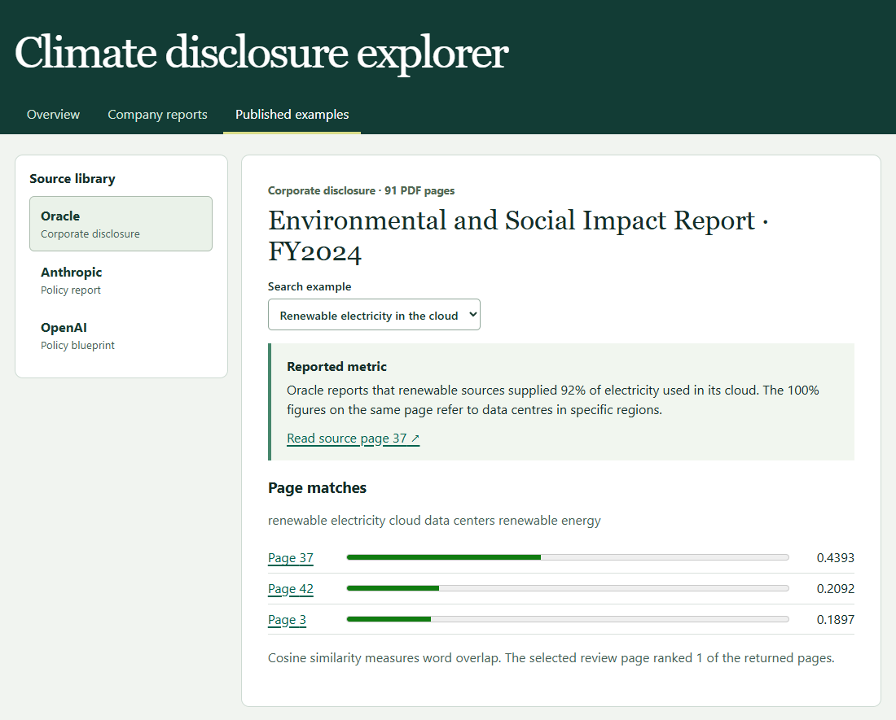

# Public report case studies

[Overview](README.md)　·　**Case studies**　·　[Reproduce a case](CONTRIBUTING.md)

Six searches across three publisher PDFs (142 pages) illustrate how wording, document type and reporting scope affect retrieval. Each search ranks pages within one PDF. The interpretations below are editorial readings of the source pages.

## Oracle

Environmental and Social Impact Report · FY2024 · Corporate disclosure. [Publisher PDF](https://www.oracle.com/a/ocom/docs/environmental-and-social-impact-report-2024.pdf)

### Renewable electricity in the cloud

Oracle reports that renewable sources supplied 92% of electricity used in its cloud. The 100% figures on the same page refer to data centres in specific regions. [Read PDF page 37](https://www.oracle.com/a/ocom/docs/environmental-and-social-impact-report-2024.pdf#page=37)

Search terms: `renewable electricity cloud data centers renewable energy`. Ranked pages (cosine): [p. 37](https://www.oracle.com/a/ocom/docs/environmental-and-social-impact-report-2024.pdf#page=37) (0.4393), [p. 42](https://www.oracle.com/a/ocom/docs/environmental-and-social-impact-report-2024.pdf#page=42) (0.2092), [p. 3](https://www.oracle.com/a/ocom/docs/environmental-and-social-impact-report-2024.pdf#page=3) (0.1897).

### Water and waste targets

The FY2024 report lists 2025 goals to cut potable water use and landfill waste per square foot by 33%. These are targets with an intensity denominator. [Read PDF page 36](https://www.oracle.com/a/ocom/docs/environmental-and-social-impact-report-2024.pdf#page=36)

Search terms: `potable water use waste to landfill per square foot`. Ranked pages (cosine): [p. 36](https://www.oracle.com/a/ocom/docs/environmental-and-social-impact-report-2024.pdf#page=36) (0.3623), [p. 42](https://www.oracle.com/a/ocom/docs/environmental-and-social-impact-report-2024.pdf#page=42) (0.1595), [p. 89](https://www.oracle.com/a/ocom/docs/environmental-and-social-impact-report-2024.pdf#page=89) (0.1507).

## Anthropic

Build AI in America · July 2025 · Policy report. [Publisher PDF](https://assets.claude.com/0dc382a2086f6a054eeb17e8a531bd9625b8e6e5.pdf)

### Projected power demand

Anthropic projects that US AI workloads may need at least 50 GW of electrical capacity by 2028. Page 3 summarizes the estimate. Page 5 explains its national scope. [Read PDF page 5](https://assets.claude.com/0dc382a2086f6a054eeb17e8a531bd9625b8e6e5.pdf#page=5)

Search terms: `electric capacity gigawatts AI workloads United States 2028`. Ranked pages (cosine): [p. 3](https://assets.claude.com/0dc382a2086f6a054eeb17e8a531bd9625b8e6e5.pdf#page=3) (0.2959), [p. 7](https://assets.claude.com/0dc382a2086f6a054eeb17e8a531bd9625b8e6e5.pdf#page=7) (0.1785), [p. 2](https://assets.claude.com/0dc382a2086f6a054eeb17e8a531bd9625b8e6e5.pdf#page=2) (0.1652).

### Transmission upgrades

The report proposes faster approval of transmission upgrades. It discusses when federal siting authority could accelerate a project. [Read PDF page 19](https://assets.claude.com/0dc382a2086f6a054eeb17e8a531bd9625b8e6e5.pdf#page=19)

Search terms: `transmission upgrades siting approval power lines federal lands`. Ranked pages (cosine): [p. 19](https://assets.claude.com/0dc382a2086f6a054eeb17e8a531bd9625b8e6e5.pdf#page=19) (0.2348), [p. 33](https://assets.claude.com/0dc382a2086f6a054eeb17e8a531bd9625b8e6e5.pdf#page=33) (0.1305), [p. 11](https://assets.claude.com/0dc382a2086f6a054eeb17e8a531bd9625b8e6e5.pdf#page=11) (0.1074).

## OpenAI

AI Infrastructure That Works for America · November 2026 · Policy blueprint. [Publisher PDF](https://cdn.openai.com/pdf/compute-campus-policy-blueprint.pdf)

### Power-use reporting

OpenAI recommends consistent reporting of facility electricity use and annual power usage effectiveness. A recommendation establishes no measured efficiency value. [Read PDF page 8](https://cdn.openai.com/pdf/compute-campus-policy-blueprint.pdf#page=8)

Search terms: `annual power usage effectiveness facility electricity reporting`. Ranked pages (cosine): [p. 8](https://cdn.openai.com/pdf/compute-campus-policy-blueprint.pdf#page=8) (0.2003), [p. 12](https://cdn.openai.com/pdf/compute-campus-policy-blueprint.pdf#page=12) (0.0759), [p. 2](https://cdn.openai.com/pdf/compute-campus-policy-blueprint.pdf#page=2) (0.0653).

### On-site cooling

OpenAI describes a planned recirculating cooling system for the Effingham site. The passage describes a design choice and anticipated water demand. [Read PDF page 8](https://cdn.openai.com/pdf/compute-campus-policy-blueprint.pdf#page=8)

Search terms: `closed-loop cooling water consumption low-emission backup generation`. Ranked pages (cosine): [p. 8](https://cdn.openai.com/pdf/compute-campus-policy-blueprint.pdf#page=8) (0.2631), [p. 7](https://cdn.openai.com/pdf/compute-campus-policy-blueprint.pdf#page=7) (0.1628), [p. 11](https://cdn.openai.com/pdf/compute-campus-policy-blueprint.pdf#page=11) (0.0530).

## How to interpret the results

The selected review page ranked first for five of the six searches. For the Anthropic demand forecast, page 5 fell outside the top three even though it explains the estimate. Page 3 repeats the figure and ranked first. Repeated summaries, PDF reading order and vocabulary all influence ranking.

These six curated examples illustrate behaviour. They are too few to estimate accuracy on new documents. The page ranker fits its vocabulary within each report. Scores describe lexical similarity and should be compared within a query. The separate sentence-matching demo uses a reference list and a different threshold.

[Download the recorded results](examples/case-results.json) · [Run the comparison](CONTRIBUTING.md)
