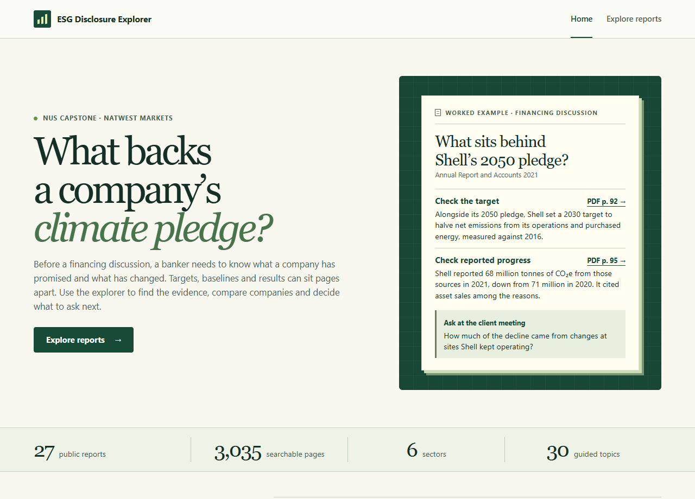

# ESG Disclosure Explorer

[**Try the live dashboard →**](https://fancasta.github.io/climate-disclosure-explorer/)　·　**Overview**　·　[Case studies](CASE_STUDIES.md)　·　[Reproduce a case](CONTRIBUTING.md)

Search **3,035 pages from 27 reports** across automotive, utilities, oil and gas, real estate, diversified businesses and technology. Enter your own terms or use 30 guided searches across environmental, social and governance topics. Every result identifies its report and physical PDF page.

The project began as **Using Machine Learning to Explore Decarbonisation Strategies**, an NUS Business Analytics capstone for NatWest Markets (August–December 2022). The original pipeline identifies transition-plan indicators in corporate reports. The public edition adds cross-report search, sector comparisons and later publications from Oracle, Anthropic and OpenAI.

Bankers preparing a financing discussion need to see which emissions a company’s pledge covers and what progress it can show. Different definitions and long reports make peer comparisons slow. The capstone links each indicator to a passage so an analyst can check its scope and bring specific questions to a client meeting.

**Worked example.** Shell’s 2021 report set a 2030 target to halve net Scope 1 and 2 emissions under its operational control against 2016 levels. Its results section lists asset sales among the reasons direct emissions fell. An analyst could ask how much of the decline came from changes at sites Shell kept operating. [Read the target on PDF page 92](https://fancasta.github.io/climate-disclosure-explorer/?publisher=Shell&page=92) · [Check the reported progress on PDF page 95](https://fancasta.github.io/climate-disclosure-explorer/?publisher=Shell&page=95)

[](https://fancasta.github.io/climate-disclosure-explorer/)

## Try a search

| Guided search | Matching pages | Reports |
| --- | ---: | ---: |
| [Water stewardship](https://fancasta.github.io/climate-disclosure-explorer/?topic=Water+stewardship) | 126 | 24 |
| [Collective bargaining](https://fancasta.github.io/climate-disclosure-explorer/?topic=Collective+bargaining) | 55 | 16 |
| [Board independence](https://fancasta.github.io/climate-disclosure-explorer/?topic=Board+independence) | 24 | 9 |

Choose a question to compare companies. Select a company to see its matching pages and open the source passage. For example, the water search leads to NRG Energy’s description of cooling towers on PDF page 42. Counts indicate where a topic is discussed. A reader can then examine whether the passage describes a target, an action or a measured outcome. [Read the NRG Energy passage](https://fancasta.github.io/climate-disclosure-explorer/?topic=Water+stewardship&publisher=NRG+Energy&page=42) · [Case studies and search methods](CASE_STUDIES.md)

## Run a search

With Python 3.12, install the demo dependencies. The small fictional PDF is included.

```sh
python -m pip install -r requirements-demo.txt
python evidence.py examples/mock-report.pdf examples/reference.txt
python -m unittest -v test_evidence test_review_reports
```

The sentence matcher returns one JSON record per page, including the source sentence, matched reference and cosine score. It flags blank pages and weak matches. The public-report study uses a separate page-ranking method that fits vocabulary across each document. Its six queries, PDF fingerprints and top-three results are available in the [case study file](CASE_STUDIES.md).

## Original capstone

The 2022 dashboard paired nine climate-disclosure indicators with supporting sentences. For the long-term net-zero classifier, the training data contains 1,003 labelled sentences, including 196 positive examples. [Original labelled dataset](https://github.com/CWei88/Group17-Capstone/blob/4ea9478a551bafa79449aa4105246ee9c9aebf75/pipeline/Notebooks/training_datasets/Attribute%2012/A12.csv) · [Dashboard schema](https://github.com/fancasta/esg-disclosure-dashboard/blob/538607eb71014d29e5b3d88bc7a8a49bde72fdd9/mysql/backup.sql)

## Project components

| Component | Purpose |
| --- | --- |
| [Page retrieval](review_reports.py) | Normalize PDF text, weight terms within each document and rank pages for a query. |
| [Sentence retrieval](evidence.py) | Trace a match back to the candidate sentence, reference row and PDF page. |
| [Full capstone pipeline](pipeline/) | The upstream research code extracts text, tables and environmental disclosure attributes. Its [original setup instructions](https://github.com/CWei88/Group17-Capstone/blob/4ea9478a551bafa79449aa4105246ee9c9aebf75/README.md) describe the Python 3.9 environment and model files. |
| [Companion dashboard](https://github.com/fancasta/esg-disclosure-dashboard#readme) | Search 27 public reports, explore original company filings and trace findings to physical PDF pages. |
