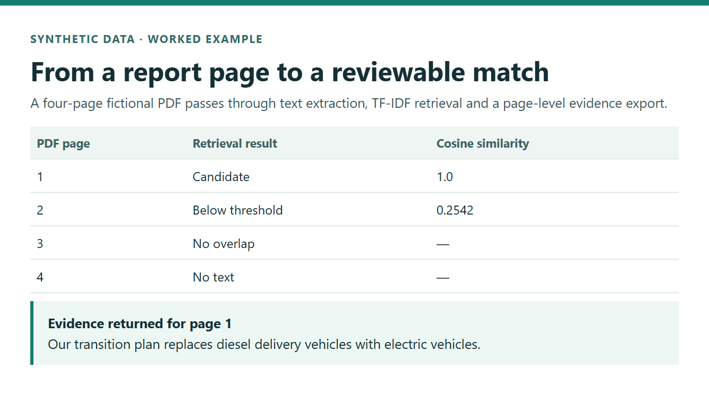

# Finding transition-plan evidence in climate disclosures

A sustainability report can span hundreds of pages. A reviewer looking for a low-carbon transition plan needs the passage, its page and a reason to inspect it. This fork of the [Group 17 decarbonisation capstone](https://github.com/CWei88/Group17-Capstone) features my work on extracting report text and retrieving candidate sentences.

## My contribution

I developed the PDF extraction and sentence-retrieval notebooks in my own repository in October 2022. The extraction notebook preserves page breaks, cleans fragmented lines and prepares sentences for analysis. The transition-plan notebook builds a reference corpus and uses TF-IDF and cosine similarity to find passages with related wording. You can trace the work through my [vectorizer revision](https://github.com/fancasta/Draft-Text-Processing-Pipeline/commit/53fd9880e8999fc47af17406cad846aee31c3809) and [retrieval revision](https://github.com/fancasta/Draft-Text-Processing-Pipeline/commit/c56fea83abcec98c8d876d5162effd8c990cc531). Both notebooks appear in the [team snapshot](https://github.com/fancasta/Group17-Capstone/tree/ae337c4f2a97b56cea8af7dad2a108e092989585).

## Try the evidence pipeline

The current fork adds a small, offline example. It reads the text layer of a PDF, splits each page into sentences, compares them with a reference list, and emits one JSON record per page. Each match retains the actual report sentence and the reference row used to fit the vectorizer. The same row-selection function now backs the historical transition-plan notebook.



With Python 3.12, run the following from the repository root.

```sh
python -m pip install -r requirements-demo.txt
python evidence.py examples/mock-report.pdf examples/reference.txt
python -m unittest -v test_evidence
```

The [example PDF](examples/mock-report.pdf) and [three reference sentences](examples/reference.txt) are fictional. Try changing a reference and rerunning the command. A cosine score at or above the original 30-degree cutoff (about 0.866) flags a passage for review. Similar wording can support different claims, and a paraphrase can score poorly. A reviewer still needs to read the passage. Scanned pages without a text layer return `no_text`.

The [portable implementation](evidence.py) runs independently of the historical notebooks, which use the original PDF paths, NLP assets and corpus layout. The broader sector datasets and other disclosure attributes belong to the team project.
