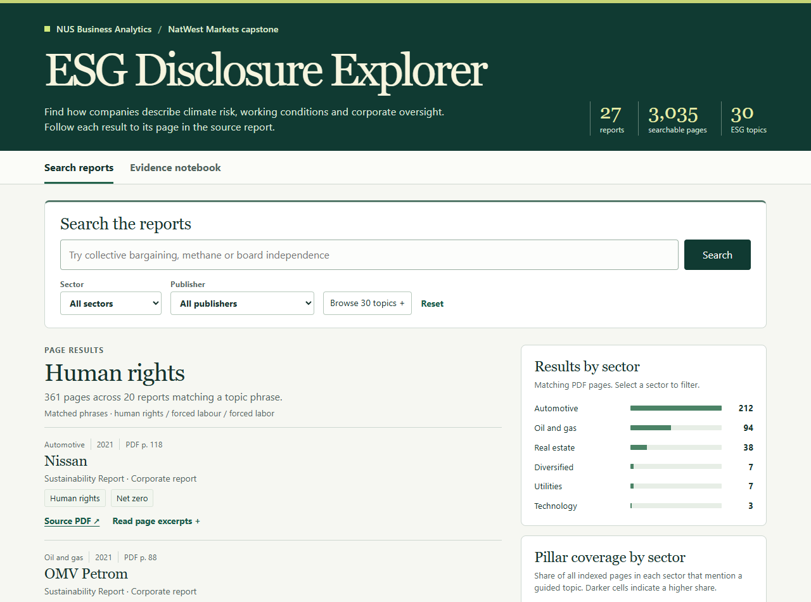

# ESG Disclosure Explorer

[**Try the live dashboard →**](https://fancasta.github.io/climate-disclosure-explorer/)　·　**Overview**　·　[Case studies](CASE_STUDIES.md)　·　[Reproduce a case](CONTRIBUTING.md)

Search **3,035 pages from 27 reports** across automotive, utilities, oil and gas, real estate, diversified businesses and technology. Enter your own terms or use 30 guided searches across environmental, social and governance topics. Every result identifies its report and physical PDF page.

The project began as **Using Machine Learning to Explore Decarbonisation Strategies**, an NUS Business Analytics capstone for NatWest Markets (August–December 2022). The original pipeline identifies transition-plan indicators in corporate reports. The public edition adds cross-report search, sector comparisons and later publications from Oracle, Anthropic and OpenAI.

[](https://fancasta.github.io/climate-disclosure-explorer/)

## Try a search

| Guided search | Matching pages | Reports |
| --- | ---: | ---: |
| [Water stewardship](https://fancasta.github.io/climate-disclosure-explorer/?topic=Water+stewardship) | 126 | 24 |
| [Collective bargaining](https://fancasta.github.io/climate-disclosure-explorer/?topic=Collective+bargaining) | 55 | 16 |
| [Board independence](https://fancasta.github.io/climate-disclosure-explorer/?topic=Board+independence) | 24 | 9 |

Use **Read page excerpts** to open passages from the source, or **Evidence notebook** for ten annotated examples. The sector chart counts matching pages. The coverage grid shows the share of indexed pages containing a topic from each ESG pillar. [Case studies and search methods](CASE_STUDIES.md)

## Explore the results

- **Oracle** reports 92% renewable electricity use in its cloud. The report also lists regional figures and future targets. The case study traces each number to its scope. [Oracle examples](CASE_STUDIES.md#oracle)
- **Anthropic** projects US power capacity needs for AI in 2028. Its executive summary outranks the page that explains the forecast, illustrating how repeated wording affects search. [Anthropic examples](CASE_STUDIES.md#anthropic)
- **OpenAI** proposes facility-level electricity reporting and describes a cooling system planned for one site. The examples show why document type matters when interpreting a match. [OpenAI examples](CASE_STUDIES.md#openai)

## Run a search

With Python 3.12, install the demo dependencies. The small fictional PDF is included.

```sh
python -m pip install -r requirements-demo.txt
python evidence.py examples/mock-report.pdf examples/reference.txt
python -m unittest -v test_evidence test_review_reports
```

The sentence matcher returns one JSON record per page, including the source sentence, matched reference and cosine score. It flags blank pages and weak matches. The public-report study uses a separate page-ranking method that fits vocabulary across each document. Its six queries, PDF fingerprints and top-three results are available in the [case study file](CASE_STUDIES.md).

## Project components

| Component | Purpose |
| --- | --- |
| [Page retrieval](review_reports.py) | Normalize PDF text, weight terms within each document and rank pages for a query. |
| [Sentence retrieval](evidence.py) | Trace a match back to the candidate sentence, reference row and PDF page. |
| [Full capstone pipeline](pipeline/) | The upstream research code extracts text, tables and environmental disclosure attributes. Its [original setup instructions](https://github.com/CWei88/Group17-Capstone/blob/4ea9478a551bafa79449aa4105246ee9c9aebf75/README.md) describe the Python 3.9 environment and model files. |
| [Companion dashboard](https://github.com/fancasta/esg-disclosure-dashboard#readme) | Search 27 public reports, explore original company filings and trace findings to physical PDF pages. |
